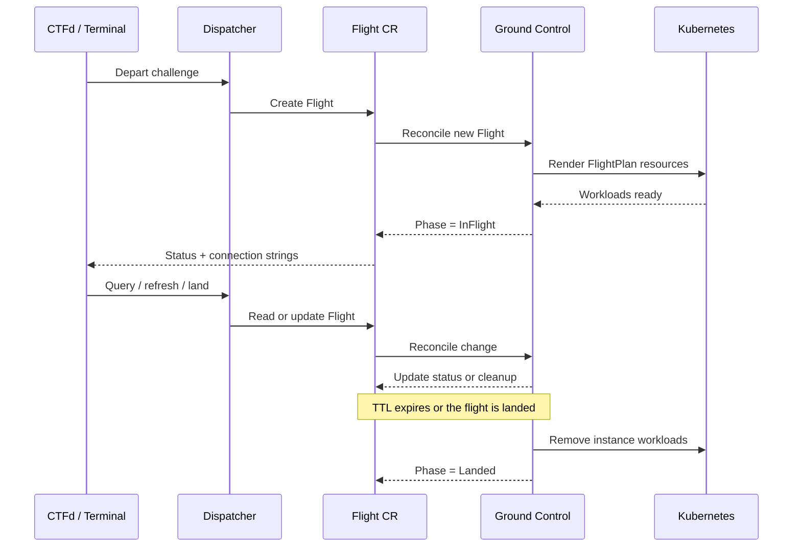

# CTF Pilot Flight Ops

> [!TIP]
> Flight Ops allows for deploying a dynamic number of challenge instances, flights, using pre-defined deployment templates, flight plans, using a REST API, within a Kubernetes cluster.

> [!IMPORTANT]
> CTF Pilot Flight Ops replaces [Kube-CTF](https://github.com/ctfpilot/kube-ctf), and is the actively maintained instancing system for CTF Pilot.

Flight Ops, is an instancing system for Kubernetes, built to run in the CTF Pilot ecosystem.  
It is designed to dynamically deploy and manage instances, called **flights**, based on pre-determined templates, called **flight plans**.

The system is built for CTF environments where challenges with a set deployment can by dynamically deployed and managed on a per-team or per-player basis.
It provides an API for handling the flights, including creating, inspecting, refreshing and landing flights, requiring only that flight plans to be pre-defined and deployed in the cluster.

In order to support *multiple* scoreboards requesting flights, the system is designed to handle multiple scoreboards, called **terminals**, with each flight being linked to the specific terminal that requested it.
This allows for multiple scoreboards to request flights from the same flight plan, without interfering with each other.

The system builds on the notion of a "flight" as a challenge instance, and a "flight plan" as the template for that instance, with a flight being either pending, in-flight, landing, or failed.
It is designed to be extensible, and allows deploying a large varirety of Kubernetes resources.

As a security measure, the system automatically deploy flights with best-pracitces in mind on a deployment-level, insuring service account and service links are disabled, along with DNS configured to public DNS servers (Cloudflare and Google). This helps flights to be more secure, but does not protect specific misconfiguration.
It is important to note that Flight Ops does not manage network seperation and isolation, and it it the operator of the system to ensure that proper network isolation is configured for the system and namespace.
Flights are deployed into a shared namespace, and are labeled for easy identification and tracking. Automatic cleanup is built-in, and flights are automatically removed when they expire or are manually landed.

> [!NOTE]
> CTF Pilot Flight Ops is made to work with any scoreboard, but we have only developed a plugin for CTFd: [CTFd Flight Ops plugin](https://github.com/ctfpilot/ctfd-flight-ops-plugin).
> 
> You can use this directly, natively with the CTF Pilot ecosystem, or you can use the plugin, Ground Control and Dispatcher as standalone systems.
> You are welcome to develop your own plugin for your scoreboard, and use the [CTFd Flight Ops plugin](https://github.com/ctfpilot/ctfd-flight-ops-plugin) as a reference implementation.

## How It Works

The system has two main pieces:

- The operator, called **Ground Control**, watches `FlightPlan` and `Flight` custom resources.
- The API, called **Dispatcher**, is the HTTP API that CTFd, a terminal, or another scoreboard uses to request and manage flights.

The lifecycle of a flight is as follows:

1. A `FlightPlan` stores the blueprint for a challenge.
2. The Dispatcher creates a `Flight` when a player or team asks for an instance.
3. Ground Control is notified of the Flight, and renders the plan into Kubernetes objects, forces them into the instanced namespace, fill templated values, and adds tracking labels and owner references.
4. When the workload is ready, the `Flight` status reports the phase, connection strings, launch time, and expiration time.
5. The dispatcher can query that status, refresh the Time-To-Live (TTL), or land the instance.

Sequence diagram of the lifecycle:



## Core Concepts

### FlightPlan

`FlightPlan` is the cluster-scoped blueprint for a challenge. It contains:

- `spec.mode`: `shared` or `instanced`.
- `spec.category`: challenge type such as web or pwn.
- `spec.defaultTTL`: default lifetime in seconds for instanced flights.
- `spec.firstDepartureAt`: optional unix timestamp for delayed availability - Currently not functional.
- `spec.endpoints.subdomains`: instanced subdomains used for Traefik routing.
- `spec.endpoints.connectionTemplate`: connection text shown for shared challenges.
- `spec.resources`: raw Kubernetes YAML manifests for the challenge workload, with optional Go template variables for dynamic values. The manifests are applied to the instanced namespace when a flight is created.

The resources are treated as Go templates before they are applied. The controller injects values such as `deploymentID`, `ownerID`, `terminalID`, `domain`, and `registryPrefix`, then rewrites the objects into the configured instanced namespace.

Only resource kinds allowed by the operator configuration are accepted. These include common challenge objects such as `Deployment`, `Service`, `ConfigMap`, `Secret`, `Ingress`, `IngressRoute`, `IngressRouteTCP`, `IngressRouteUDP`, and `PersistentVolumeClaim`. It is possible to further restrict the allowed kinds, but extending the list requires a custom RBAC configuration, which is not configurable in the deployment of the operator.

### Flight

`Flight` is the per-request instance created from a `FlightPlan`. It is namespaced and carries the request identity and runtime state:

- `spec.flightPlanRef`: the `FlightPlan` name, for which the flight is being requested.
- `spec.ownerID`: player or team ID.
- `spec.terminalID`: requesting terminal or scoreboard identity, e.g. `ctfd`, `pilot-terminal`, or `custom-terminal`.
- `spec.deploymentID`: unique identifier (UUID) for the flight.
- `spec.ttl`: override for the default flight lifetime.
- `spec.domain`: base domain used to render flight URLs

The status is what the scoreboard reads back:

- `status.phase`: `Pending`, `InFlight`, `Landed`, or `Failed`.
- `status.connectionStrings`: rendered access strings returned to the terminal, formatted as a list.
- `status.launchedAt`: the time at which the flight departed, and became in-flight.
- `status.expiresAt`: when the flight will be automatically landed, or `null` if the flight is shared and does not expire.

## Dispatcher API

The Dispatcher exposes a small HTTP REST API for managing flights and observing status.

The full API is available as an OpenAPI spec in [`dist/dispatcher/openapi.yaml`](./dist/dispatcher/openapi.yaml).

The dispatcher exposes the following generic endpoints:

- `GET /api/status` or `GET /status`: health check
- `GET /api/version`: build version

The plan-scoped endpoints are admin-gated and the Dispatcher returns sanitized FlightPlan objects. The `resources` field is redacted in API responses, so clients should treat it as unavailable data rather than a rendered manifest payload.

Flight plans endpoints:

- `GET /api/flightplans`: list accessible flight plans for admin callers.
- `GET /api/flightplans/{name}`: read a flight plan for admin callers.
- `GET /api/flightplans/{name}/flights`: list flights for a flight plan.
- `POST /api/flightplans/{name}/depart`: create a new flight from a flight plan.
- `POST /api/flightplans/{name}/refresh`: refresh the caller's flights for a flight plan.
- `POST /api/flightplans/{name}/land`: land the caller's flights for a flight plan.

Flight endpoints:

- `GET /api/flights`: list flights.
- `GET /api/flights/{name}`: read a flight and its status.
- `POST /api/flights/{name}/refresh`: refresh a flights TTL.
- `POST /api/flights/{name}/land`: land a flight.

Requests are authenticated with JWTs and rate-limited through Redis. The limiter is keyed by the caller identity, terminal, and action.

## Configuration

### Ground Control operator

The operator is configured through command-line flags on the manager container:

- `--namespace-instanced`: namespace used for deployed challenge instances. Default: `flights-instanced`.
- `--allowed-kinds`: comma-separated list of manifest kinds permitted in `FlightPlan.spec.resources`, must also be allowed by RBAC.
- `--registry-prefix`: image registry base used when templating challenge manifests. Default: `ghcr.io`.
- `--leader-elect`: enable leader election for HA deployments.
- `--metrics-bind-address`: metrics bind address, commonly `:8443`.
- `--metrics-secure`: serve metrics over HTTPS.
- `--metrics-cert-path`, `--metrics-cert-name`, `--metrics-cert-key`: custom metrics TLS material.
- `--webhook-cert-path`, `--webhook-cert-name`, `--webhook-cert-key`: webhook TLS material.
- `--enable-http2`: enable HTTP/2 on the webhook and metrics servers.

For local development, `make run` starts the operator. If webhook TLS certs are missing, create them under `/tmp/k8s-webhook-server/serving-certs/` before launching.

### Dispatcher

The dispatcher is configured by environment variables, which are also available as Helm values in `dist/dispatcher/chart/values.yaml`:

- `PORT` / `dispatcher.port`: HTTP listen port. Default: `8080`.
- `METRICS_BIND_ADDRESS` / `metrics.service.port`: metrics listen port. Default `:9090`.
- `NAMESPACE` / `dispatcher.namespace`: Kubernetes namespace to query for flights. Default: `flights-instanced`.
- `VERSION` / `dispatcher.version`: version returned by `/api/version`.
- `FLIGHT_DOMAIN` / `dispatcher.flightDomain`: base domain used to render challenge URLs.
- `MAX_CONCURRENT_FLIGHTS` / `dispatcher.maxConcurrentFlights`: global cap on running flights per player.
- `SERVER_SECRET` / `dispatcher.serverSecret`: internal secret used when generating deterministic flight ids.
- `JWT_SECRET` / `dispatcher.jwt.secret`: JWT signing secret.
- `JWT_ISSUERS` / `dispatcher.jwt.issuers`: allowed token issuers, comma-separated list.
- `JWT_AUDIENCE` / `dispatcher.jwt.audience`: allowed audience claim.
- `JWT_EXPIRATION` / `dispatcher.jwt.expiration`: token lifetime in seconds.
- `REDIS_ADDR` / `dispatcher.redis.address`: Redis host and port for rate limiting.
- `REDIS_DB` / `dispatcher.redis.db`: Redis database to use for rate limiting.
- `REDIS_KEY_PREFIX` / `dispatcher.redis.keyPrefix`: Redis key prefix for limiter buckets.
- `REDIS_PASSWORD` / `dispatcher.redis.password`: Redis password if required.
- `RATE_LIMIT_TIMEOUT_MS` / `dispatcher.redis.requestTimeoutMs`: Redis request timeout.
- `RATE_LIMIT_LIST_MAX`, `RATE_LIMIT_LIST_WINDOW_SECONDS` / `dispatcher.rateLimits.list.<max,windowSeconds>`: rate limit max for window in seconds for listing flights and flight plans.
- `RATE_LIMIT_READ_MAX`, `RATE_LIMIT_READ_WINDOW_SECONDS` / `dispatcher.rateLimits.read.<max,windowSeconds>`: rate limit max for window in seconds for reading flights and flight plans.
- `RATE_LIMIT_DEPART_MAX`, `RATE_LIMIT_DEPART_WINDOW_SECONDS` / `dispatcher.rateLimits.depart.<max,windowSeconds>`: rate limit max for window in seconds for departing flights.
- `RATE_LIMIT_REFRESH_MAX`, `RATE_LIMIT_REFRESH_WINDOW_SECONDS` / `dispatcher.rateLimits.refresh.<max,windowSeconds>`: rate limit max for window in seconds for refreshing flights.
- `RATE_LIMIT_LAND_MAX`, `RATE_LIMIT_LAND_WINDOW_SECONDS` / `dispatcher.rateLimits.land.<max,windowSeconds>`: rate limit max for window in seconds for landing flights.

The dispatcher chart also exposes `metrics.enabled`, `metrics.serviceMonitor.enabled`, and `metrics.networkPolicy.enabled` for Prometheus and cluster access control.

## JWT

The dispatcher only accepts Bearer tokens signed with HMAC using the shared secret configured in `JWT_SECRET` or `dispatcher.jwt.secret`.

Required JWT configuration:

- `JWT_SECRET`: HMAC signing secret.
- `JWT_ISSUERS`: comma-separated list of allowed issuers.

Optional JWT configuration:

- `JWT_AUDIENCE`: expected audience claim. Default: `ground-control-dispatcher`.
- `JWT_EXPIRATION`: maximum token lifetime in seconds. Default: `3600`.

The token must include these claims and scopes:

- `iss`: JWT issuer, must be in the configured list of allowed issuers.
- `aud`: JWT audience, must match the configured audience.
- `exp`, `iat`, `nbf`: Experation, Issues at, and Not before; valid timestamps, with `exp - iat` no larger than `JWT_EXPIRATION`.
- `jti`: JWT Id, should be unique. For future replay protection usage.
- `flight`: dispatcher context payload.

The `flight` object must include:

- `action`: one of `list`, `read`, `depart`, `land`, or `refresh`.
- `owner`: Kubernetes-safe owner ID.
- `terminal`: Kubernetes-safe terminal ID.
- `flight_plan`: flight plan name, required for flight-plan scoped actions such as `get flight plan`, `list flights for a plan`, `depart`, `refresh plan`, and `land plan`.
- `flight`: flight name, required for flight-scoped actions such as `get flight`, `refresh flight`, and `land flight`
- `ttl`: optional positive TTL for depart requests.
- `admin`: optional boolean used for broader access; it is required for listing and reading flight plans, and it broadens flight list/read access to all flights visible in the namespace.

Example payload:

```json
{
  "iss": "issuer1",
  "aud": ["ground-control-dispatcher"],
  "exp": 1730003600,
  "iat": 1730000000,
  "nbf": 1730000000,
  "jti": "local-dev-1",
  "flight": {
    "admin": true,
    "owner": "owner",
    "terminal": "terminal",
    "flight_plan": "demo-plan",
    "flight": "demo-flight",
    "ttl": 3600,
    "action": "depart"
  }
}
```

For local development, you can mint a token with the same shape and sign it with the shared secret. The repository tests use `secret` as the example signing key and accept `issuer1` or `issuer2` as valid issuers.

## Deployment

To deploy the operator and dispatcher, there is two options: either build and deploy from source, or use the packaged operator and Helm chart.

Prerequisites:

- Go 1.24+ (development only)
- Docker (development only)
- kubectl
- A Kubernetes cluster with cert-manager installed

### Ground control deployment

The Ground Control operator can be deployed from source, using packaged install manifests, or using the packaged Helm chart.

#### From source

Install the CRDs and operator from source:

```sh
make install
make deploy IMG=ghcr.io/brunnerne/ctfpilot-flight-ops-groundcontrol:latest
```

#### Packaged manifests

Install the operator with the packaged manifests:

```bash
kubectl apply -f dist/install.yaml
```

#### Helm chart

Install the operator with Helm:

```bash
helm install ground-control ./dist/chart --namespace ground-control --create-namespace
```

### Dispatcher deployment

The only supported Dispatcher deployment method is via the Helm chart.  
The Dispatcher requires a Redis instance for rate limiting, and a JWT signing secret.

Install the Dispatcher with Helm:

```bash
helm install dispatcher ./dist/dispatcher/chart --namespace dispatcher --create-namespace \
  --set dispatcher.jwt.secret.existingSecret=jwt-secret \
  --set dispatcher.serverSecret.existingSecret=dispatcher-secret \
  --set dispatcher.redis.address=redis:6379 \
  --set metrics.serviceMonitor.additionalLabels.release=kube-prometheus-stack
```

## Development

Create sample resources with:

```sh
kubectl apply -k config/samples/
```

Remove them with:

```sh
kubectl delete -k config/samples/
make undeploy
make uninstall
```

## Contributing

We welcome contributions of all kinds, from **code** and **documentation** to **bug reports** and **feedback**!

Please check the [Contribution Guidelines (`CONTRIBUTING.md`)](/CONTRIBUTING.md) for detailed guidelines on how to contribute.

To maintain the ability to distribute contributions across all our licensing models, **all code contributions require signing a Contributor License Agreement (CLA)**.
You can review **[the CLA here](https://github.com/ctfpilot/cla)**. CLA signing happens automatically when you create your first pull request.  
To administrate the CLA signing process, we are using **[CLA assistant lite](https://github.com/marketplace/actions/cla-assistant-lite)**.

*A copy of the CLA document is also included in this repository as [`CLA.md`](CLA.md).*  
*Signatures are stored in the [`cla` repository](https://github.com/ctfpilot/cla).*

This project builds [Kubebuilder](https://kubebuilder.io). See the [Kubebuilder book](https://book.kubebuilder.io/introduction.html) for the underlying operator patterns, for a more in-depth idea of how this project is structured and how to extend it.

## License

This repository is licensed under the **EUPL-1.2 License**.  
You can find the full license in the **[LICENSE](LICENSE)** file.

We encourage all modifications and contributions to be shared back with the community, for example through pull requests to this repository.  
We also encourage all derivative works to be publicly available under the **EUPL-1.2 License**.  
At all times must the license terms be followed.

For information regarding how to contribute, see the [contributing](#contributing) section above.

CTF Pilot is owned and maintained by **[The0Mikkel](https://github.com/The0mikkel)**.  
Required Notice: Copyright Mikkel Albrechtsen (<https://themikkel.dk>)

## Code of Conduct

We expect all contributors to adhere to our [Code of Conduct](/CODE_OF_CONDUCT.md) to ensure a welcoming and inclusive environment for all.
